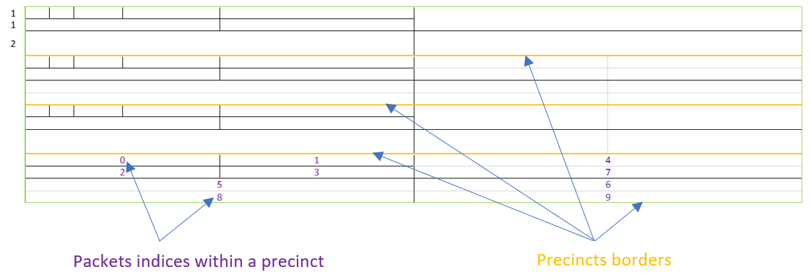
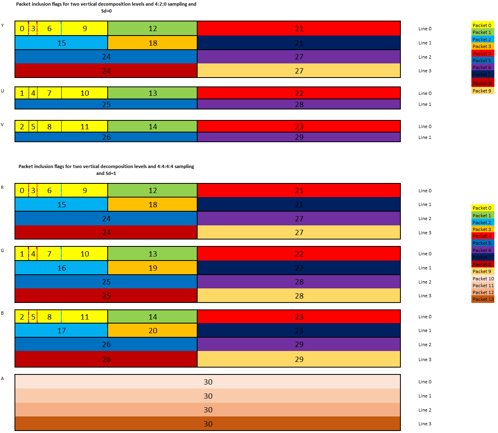
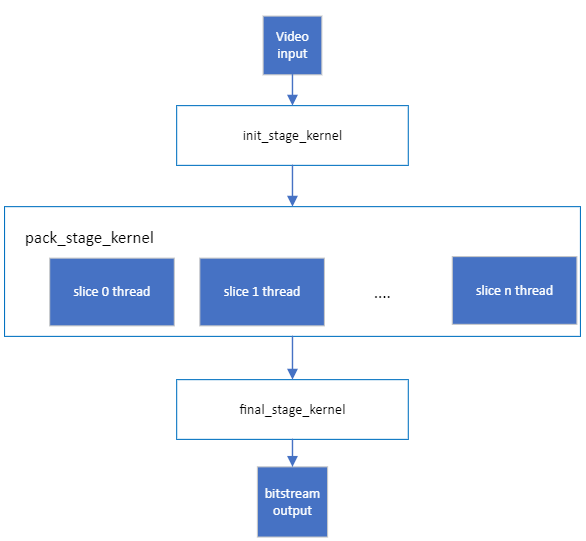
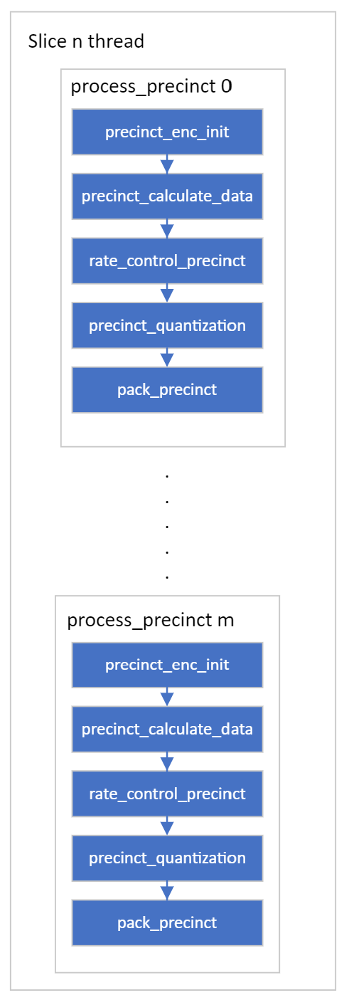

# Encoder Design for SVT-JPEGXS (Scalable Video Technology for JPEGXS Encoder)

[Top level](../../README.md)

## List of Figures

- [Figure 1](#figure-1-5-level-horizontal-and-2-level-vertical-picture-decomposition-into-bands-for-luma-component):
  5-level horizontal and 2-level vertical Picture decomposition into bands for Luma component
- [Figure 2](#figure-2-1-slice-4-precincts-and-multiple-packets-diagram): 1 Slice, 4 Precincts and multiple Packets diagram
- [Figure 3](#figure-3-packets-progression-within-precinct): Packets progression within precinct
- [Figure 4](#figure-4-high-level-encoder-process-dataflow): High-level encoder process dataflow
- [Figure 5](#figure-5-encoding-pipeline-per-slice): Encoding pipeline per slice

## List of Tables

# Introduction

This document describes the Intel SVT-JPEGXS encoder design. In particular, the encoder block diagram is described. This
document is meant to be an accompanying document to the “C Model” source code, which contains the more specific details of
the inner workings of each algorithm.

# Definitions

This section contains definitions used throughout this design document.

## General Definitions

| **Term**           | **Definition**                                                                                                                                                                                                                           |
| ------------------ | ---------------------------------------------------------------------------------------------------------------------------------------------------------------------------------------------------------------------------------------- |
| Picture            | Collection of luma and chroma samples assembled into rectangular regions with a width, height and sample bit-depth.                                                                                                                      |
| Slice              | integral number of precincts whose wavelet coefficients can be entropy-decoded independently                                                                                                                                             |
| Precinct           | collection of quantization indices of all bands contributing to a given spatial region of the image                                                                                                                                      |
| Band               | input data to a specific wavelet filter type that contributes to the generation of one of the components of the image                                                                                                                    |
| GTLI               | (values 0-15) (Greatest Trimmed Line Index) Single value calculated per band, Restored in decoder from Quantization, Refinement and WeightTables. Specify number of least significant bits that will be removed during quantization      |
| GCLI               | (values 0-31) (Greatest common line index) Max used bits in group of 4 coefficients, when value <= GTLI all coefficients will be 0                                                                                                       |
| Significance Value | Max used bits in group of 8 GCLI's or 32 coefficients , when value <= GTLI all values can be ignored.                                                                                                                                    |
| SignificationBit   | (Significance Value < GTLI) if 0 ignore group for specific GTLI when GTLI >= GCLI.                                                                                                                                                       |
| Quantization value | Quantization bits (remove least signifianct bits from value with some rounding deadzone/uniform) (Value >> GTLI) when (GTLI >= GCLI) then 0 Pack data bits – Bits to pack value in bitstream GCLI-GTLI. If less than 0 then pack 0 bits. |

## Source Partitioning

The source picture is partitioned into various slices. Each slice is further divided into precincts.

Figure 1 shows the decomposition of the picture for one component into bands after Discrete Wavelet Transform (DWT)
decomposition.

### Figure 1: 5-level horizontal and 2-level vertical Picture decomposition into bands for Luma component

Figure 2 shows the relationship between slice, precincts and packets.
A slice is divided into precincts. The grouping of lines of bands into packets is shown in the fourth precinct. Each packet
contributes to one line and one or multiple bands of a precinct.
Furthermore each packet consists of multiple subpackets where each subpacket contributes to one aspect of the data, such as
significance, GCLI, quantized coefficients and signs.

### Figure 2: 1 Slice, 4 Precincts and multiple Packets diagram

Figure 3 shows how single precinct is divided into multiple packets, (Sd=1 Number of components for which the wavelet
decomposition is suppressed)

### Figure 3: Packets progression within precinct

## High-level encoder architecture

The encoder is designed around *processes*. A process is an execution
thread in software or an IP core in hardware.

The architecture is simplistic and flexible enough to support an implementation in which
one slice at a time is encoded through the entire pipeline.

In the SVT-JPEGXS encoder, a picture is divided into slices.
Parallelism in the encoder is achieved at the slice level.
Multiple slices from the same picture could be processed simultaneously, where each process could, for example, be
performing a different task in the encoding pipeline.

A high-level diagram of the encoder pipeline is shown in Figure 4. The figure shows the Low latency CPU profile
(`CPU_PROFILE_LOW_LATENCY`), where the pipeline is `init_stage_kernel()` -> `pack_stage_kernel()` -> `final_stage_kernel()`.
In the Low CPU profile (`CPU_PROFILE_CPU`) an additional DWT stage (`dwt_stage_kernel()`) runs in parallel with the pack
stage, see [DWT Stage](#dwt-stage-low-cpu-profile-only) and [CPU Profiles](#cpu-profiles).

### Figure 4. High-level encoder process dataflow

### Initialization Stage

The initialization stage process is the first stage that takes pictures from input and split it into multiple slices.
It is a single threaded and picture-based process that handles one
picture at a time in display order.

The initialization Process assembles the input information and creates the appropriate buffers that would travel with the
input picture all along the encoding pipeline and passes this data along with the current encoder settings to the pack
stage process.

Before a picture enters the pipeline, `init_stage_kernel()` (InitStageProcess.c) waits on the `sync_output_ringbuffer_left`
condition variable until the final stage reorder ring buffer has a free entry, which bounds the number of pictures in
flight. `pre_rc_send_frame_to_pack_slices()` (PreRcStageProcess.c) then copies the precomputed picture header into the
output bitstream and posts one `PackInput_t` per slice to the pack stage. Each slice gets its byte budget
(`slice_budget_bytes`) and a fixed output window (`out_bytes_begin`..`out_bytes_end`) taken from `slice_sizes[]`, which
`svt_jpeg_xs_encoder_init()` computes once from Lcod by splitting the precinct budget proportionally to the number of
precincts per slice. The window of the last slice also reserves room for the end of codestream marker. Every slice writes
only to its own window, so slices can be packed in parallel and in any order.

In the Low CPU profile the init stage additionally links the slices of the picture into a list (`sync_dwt_list_next`) and
posts one `DwtInput` per component with non-zero vertical decomposition to the DWT stage.

### DWT Stage (Low CPU profile only)

`dwt_stage_kernel()` (DwtStageProcess.c) runs on 1 to 3 threads and receives one `DwtInput` per component. It applies the
NLT input scaling and the full vertical and horizontal wavelet transform to the whole component, writing the coefficients
to the picture-level buffer `coeff_buff_ptr_16bit`. Each time the lines of one slice are finished it sets
`sync_dwt_component_done_flag[component]` in that slice's `PackInput_t` and posts its `sync_dwt_semaphore`. In the pack
stage `precinct_calculate_data()` (GcStageProcess.c) blocks on the semaphore until the flag of the component is set and
then runs group coding on the precomputed coefficients. Components without vertical decomposition (for example the chroma
components of YUV420 with vertical decomposition 1) are not sent to the DWT stage and are transformed in the pack stage.

### Pack Stage

`pack_stage_kernel()` (PackStageProcess.c) takes one `PackInput_t` (one slice) at a time and processes all precincts of
that slice. More than one slice can be processed simultaneously. For rate control modes 0 and 1 the precincts are
processed one after another by `process_precinct()` (Figure 5). For rate control modes 2 and 3 `process_slice()` runs
separate loops over the whole slice, see [Rate Control Modes](#rate-control-modes). Precinct processing is described in
details in the encoder algorithms section.

### Final Stage

The final process is where all the synchronization is done: Releasing objects and reordering queues. Slices are properly
aligned with corresponding picture to properly reconstruct the picture from slices.

By default `final_stage_kernel()` (FinalStageProcess.c) releases one output packet per picture once all slices of the
picture are packed. When `slice_packetization_mode` is 1, it instead releases the picture header as a separate first
packet as soon as slice 0 is packed, followed by each slice as a separate packet in slice order as soon as that slice and
all previous slices are ready. The last slice packet has `last_packet_in_frame` set and marks the input image and the
bitstream buffer as ready to release.

An illustration of the slice level data processing for rate control modes 0 and 1 is shown in Figure 5.

### Figure 5. Encoding pipeline per slice

### CPU Profiles

The threading model is selected with `cpu_profile`:

- Low latency (`CPU_PROFILE_LOW_LATENCY`, 0): the pack threads compute the DWT for each precinct of their slice. The
  encoder creates one init thread, one final thread and `threads_num - 2` pack threads (minimum 1).
- Low CPU (`CPU_PROFILE_CPU`, 1): the DWT is computed per whole component in the DWT stage. The encoder creates one init
  thread, one final thread, 1 DWT thread (`threads_num` <= 8), 2 DWT threads (`threads_num` 9 to 12) or 3 DWT threads
  (`threads_num` > 12), and `threads_num - 2 - DWT threads` pack threads (minimum 1), see `svt_jpeg_xs_encoder_init()`.

Restrictions checked in `encoder_init_configuration()` (EncHandle.c):

- Vertical decomposition 0 always uses the Low latency profile, a requested Low CPU profile is silently changed.
- Packed input (`COLOUR_FORMAT_PACKED_YUV444_OR_RGB`) is rejected with the Low CPU profile.
- The reversible colour transform (`enable_color_transform`) is rejected unless the Low latency profile is requested. The
  requested value is checked, so vertical decomposition 0 does not bypass this check.

### Rate Control Modes

The rate control mode is selected with `rate_control_mode` (`RateControlType`, Encoder.h). The slice budget
`slice_budget_bytes` is always met exactly (CBR), the modes differ in how it is distributed between precincts:

- `RC_CBR_PER_PRECINCT` (0): the slice budget is split evenly between precincts (remainder bytes go to the first
  precincts) and each precinct is rate controlled against its own budget. Unused bytes are written as padding.
- `RC_CBR_PER_PRECINCT_MOVE_PADDING` (1): as mode 0, but the first precinct gets a budget larger by
  `TUNING_RC_CBR_PER_PRECINCT_MOVE_PADDING_FIRST_PREC_BIGGER_*` percent, and the padding of each precinct except the last
  one is removed and added to the budget of the next precinct (`process_precinct()`). With
  `SIGN_HANDLING_STRATEGY_FAST` the bytes recovered while packing signs (`pack_signs_handling_fast_retrieve_bytes`) are
  moved to the next precinct as well.
- `RC_CBR_PER_SLICE_COMMON_QUANT` (2): `process_slice()` first computes the DWT and group coding for all precincts of the
  slice. `rate_control_slice_quantization_fast_no_vpred_no_sign_full()` then finds a common quantization and refinement
  for the whole slice budget and assigns a budget to each precinct. Padding of the last precinct is partially moved to the
  first precinct and the rest is spread evenly over all precincts. Finally each precinct is rate controlled again by
  `rate_control_precinct()` against its budget plus the padding moved from the previous precinct, then quantized and
  packed.
- `RC_CBR_PER_SLICE_COMMON_QUANT_MAX_RATE` (3): as mode 2, but before the final loop every precinct budget is raised to at
  least the largest precinct data size divided by `TUNING_RC_CBR_PER_SLICE_MAX_PRECINCT_BUDGET_RATE`. The added bytes are
  taken from the padding of the last precinct and, if that is not enough, evenly from all precincts.

Modes 2 and 3 keep all precincts of a slice in memory per pack thread. Lossless coding always uses mode 0
(`encoder_init_configuration()` overrides `rate_control_mode`).

### Thread wake-up

The encoder threads use the normal blocking wait on their queues. The timed wait used by the decoder (see
[Thread wake-up (timed wait)](../decoder/svt-jpegxs-decoder-design.md#thread-wake-up-timed-wait)) is not applied to encoder
sessions, and the `SVT_JXS_TW_*` environment variables have no effect on the encoder. The encoder is mostly compute bound
and has few thread hand-offs per frame, so it does not benefit from the timed wait. In measurements it only used more CPU
time.

On Linux every condition variable in the library, including the encoder's, is created with
`pthread_condattr_setclock(CLOCK_MONOTONIC)`. The encoder only uses blocking waits without a timeout, so this does not
change its behaviour.

## Encoder Algorithms

The following section describes the algorithms used in the
SVT-JPEGXS encoder per slice. For rate control modes 0 and 1 the algorithms are done sequentially for each precinct in
the slice. For modes 2 and 3 each step is done for all precincts of the slice before the next step starts, see
[Rate Control Modes](#rate-control-modes).

### Precinct initialization

Coefficients buffer initialization based on bands sizes for all components (luma and chroma) of the precinct.

### Precinct Data Calculation

Picture data calculation performs two main stages: Discrete wavelet transform stage and group coding stage.

Discrete wavelet transform is applied to pixel values to decompose the picture into low frequency and high frequency
coefficients. The wavelet filtering is done vertically and horizontally. Vertical decomposition range is [0..2] inclusive
and horizontal decomposition range is [1..5] inclusive. The horizontal decomposition must be greater or equal to the
vertical decomposition, YUV420 requires vertical decomposition 1 or 2, and `slice_height` must be a multiple of
2^(vertical decomposition) (`encoder_init_configuration()`).

Before the wavelet transform, input samples are converted by `nlt_input_scaling_line()` (NltEnc.c), see
[Input Sample Scaling](#input-sample-scaling).

When the reversible colour transform is enabled (RCT, ISO/IEC 21122-1 Table F.2, signalled as Cpih=1), a forward decorrelation
step is applied to planar R, G, B samples (`COLOUR_FORMAT_PLANAR_RGB`) immediately before the wavelet transform, mirroring
the decoder's inverse RCT step. `mct_forward_rct_prepass_planar()` (GcStageProcess.c) first applies the NLT input
scaling to the R, G and B lines and then `forward_rct_line()`, and caches the transformed lines for the following DWT
calls. This is only available in the Low latency threading model and only for `COLOUR_FORMAT_PLANAR_RGB` input,
`COLOUR_FORMAT_PLANAR_RGBA` and packed input are rejected. Lossless coding with RCT is rejected for bit depths above 12,
because the RCT grows the coefficient magnitude and the 15-bit coefficient storage has no margin left.

In the Low latency profile, since wavelet transformation runs across slice boundaries and slices are encoded independently,
some precalculations are done to the first precinct in each slice to be used in the next precinct decomposition
(`precinct_component_calculate_dwt_V1_precalculate_slice()` and `precinct_component_calculate_dwt_V2_precalculate_slice()`).
This precalculation is only performed for components with vertical decomposition 1 or 2. In the Low CPU profile no
precalculation is needed, because the DWT stage transforms each component as a whole.

group coding stage has three steps:

1) Transform the dwt coefficients (some positive and some negative) into signbit(most significant bit) + abs(dwt)
2) Generate the gc code per group. If gc_group_size = 4, gc_code = the most significant non-zero bit position of (abs(dwt1) | abs(dwt2) | abs(dwt3) | abs(dwt4))
3) Signal the non-zero coefficients for the gc code generated in the step2.

### Precinct Rate Control

Precinct rate control consists of finding the best coding method with the lowest quality loss in quantization.

Truncation position (GTLI) is used for budget calculation.
Initially a search for best quantization is done through setting refinement to 0 and calculating different truncation
positions and corresponding budgets.
Then best refinement is searched based on the best quantization value selected.

GTLI is calculated from precinct quantization, precinct refinement and band priority defined by the weight table.

When lossless coding is enabled (lossless_enable, signalled as Fq=0 with Bw equal to the input bit depth), the budget search
is bypassed: GTLI is forced to 0 for every band, so no coefficient bits are truncated, quantization becomes a no-op and no
padding is added. Each precinct is coded at its real size, so the frame size is data-dependent; each slice is packed into
a pre-reserved worst-case sized output window (the pack stage fails the frame if a slice ever exceeds it), and the final
stage compacts the slices back to back and patches the real total size into the picture header (Lcod) before the frame
is released. See [Lossless Coding](#lossless-coding) for the configuration rules.

### Precinct Quantization

To further reduce the bitstream size, quantization is applied. It uses GTLI to quantize precincts coefficients.
Quantization type in JPEG XS can be deadzone or uniform.

### Precinct Pack

Packing process consists of writing encoding information to bitstream. Information consists of coding mode, GTLI, GCLI,
quantization, refinement, transformation coefficients for each band, and any necessary information that the decoder needs
to reconstruct the video following the JPEG XS specification.

### Coding Tools

The coding tools below are configured in `encoder_init_configuration()` (EncHandle.c) and evaluated per band or per
packet by the precinct rate control (RateControl.c), which selects the cheapest enabled method.

- Significance coding: `coding_significance` (default 1) enables the significance coding method. Group coding precomputes
  the maximum GCLI per significance group (`gc_precinct_sigflags_max()`) so that rate control can compare the cost with and
  without significance flags for each band.
- Vertical prediction: `coding_vertical_prediction_mode` 0 disables vertical prediction of GCLIs, 1 enables it with runs
  of zero prediction residuals (`METHOD_PRED_ZERO_RESIDUAL`, Rm=0) and 2 with runs of zero coefficients
  (`METHOD_PRED_ZERO_COEFFICIENTS`, Rm=1). The first band line is predicted from the last line of the previous precinct of the
  same slice (`precinct_top`), so the pack stage keeps the previous precinct in memory.
- Sign handling: `coding_signs_handling` 0 (`SIGN_HANDLING_STRATEGY_OFF`) codes signs jointly with the data (Fs=0). 1
  (`SIGN_HANDLING_STRATEGY_FAST`) and 2 (`SIGN_HANDLING_STRATEGY_FULL`) code signs separately (Fs=1). With FAST, rate
  control budgets a sign bit for every coefficient of a non-zero group, and the bytes not used by signs after packing are
  recovered (`pack_signs_handling_fast_retrieve_bytes`) and moved to the next precinct in rate control modes 1 to 3. With
  FULL, rate control counts the exact number of non-zero coefficients. Selecting FAST prints a warning.
- Raw mode: by default Rl=1 and `precinct_get_budget_bytes()` codes the GCLIs of a packet in raw mode when that is smaller
  than the coded size. `coding_raw_disable` = 1 sets Rl=0, raw packets are never selected and the raw-mode capability bit
  is cleared.

### Input Sample Scaling

`nlt_input_scaling_line()` (NltEnc.c) converts each input line to wavelet input with the linear NLT (Tnlt=0): samples are
shifted left by Bw minus the input bit depth and the DC offset 2^(Bw-1) is subtracted. Bw is 20 for lossy coding and
equal to the input bit depth for lossless coding.

With `input_bit_depth_msb_aligned` = 1 (only used for bit depths above 8) samples occupy the high bits of each 16-bit
word, so the shift is Bw - 16 independent of the bit depth and no masking is applied. It is rejected together with
lossless coding.

### Input Formats

`encoder_init_configuration()` maps `COLOUR_FORMAT_PLANAR_RGB` to `COLOUR_FORMAT_PLANAR_YUV444` and
`COLOUR_FORMAT_PLANAR_RGBA` to `COLOUR_FORMAT_PLANAR_4_COMPONENTS` internally. They only declare the component order and
are coded the same way.

Packed input (`COLOUR_FORMAT_PACKED_YUV444_OR_RGB`, interleaved 4:4:4 samples) is handled in `precinct_calculate_data()`
(GcStageProcess.c): the input lines needed by a precinct are converted to planar lines in a temporary buffer
(`convert_packed_to_planar_rgb_8bit()` or `convert_packed_to_planar_rgb_16bit()`) before the DWT. Packed input is only
supported in the Low latency profile and without RCT.

4-component formats are `COLOUR_FORMAT_PLANAR_YUV422_ALPHA` (4:2:2:4), `COLOUR_FORMAT_PLANAR_4_COMPONENTS` (4:4:4:4) and
`COLOUR_FORMAT_PLANAR_RGBA`. Their weight tables are built by `weight_table_build_4comp()` (WeightTable.c): the
3-component table (4:2:2 for `COLOUR_FORMAT_PLANAR_YUV422_ALPHA`, 4:4:4 otherwise) is resolved first, and
`weight_table_extend_4comp_alpha_last()` appends the alpha bands with the luma gains and with priorities after all colour
bands, so alpha is refined last.

### Lossless Coding

Lossless coding is enabled with `lossless_enable`. `encoder_init_configuration()` (EncHandle.c) applies these rules:

- `bpp_numerator` and `bpp_denominator` are ignored. Lcod is set to the worst-case frame size computed by
  `lossless_worst_case_bytes_per_frame()` from the band geometry, and initialization fails if this exceeds 4 GB.
- `rate_control_mode` is forced to `RC_CBR_PER_PRECINCT`, Bw is set to the input bit depth and Fq to 0.
- `input_bit_depth_msb_aligned` = 1 and `slice_packetization_mode` = 1 are rejected. Slice packetization releases the
  picture header before the real frame size is known, so Lcod could not be patched.
- RCT is rejected for bit depths above 12.

### Profile, Level and Capabilities

The profile (Ppih) and level (Plev) are written verbatim into the picture header. Unless overridden with
`profile_ppih_override` (0 means auto) and `level_plev_override` (0xFFFF means auto), they are derived in ProfileLevel.c:

- `derive_stream_profile_ppih()` selects MLS.12 for lossless coding. Otherwise it selects Main 420.12 for YUV420,
  Main 4444.12 for 4-component formats, Main 444.12 for 4:4:4 and packed input, and Main 422.10 for YUV422 and YUV400
  (Main 444.12 above 10 bit). A warning is printed for bit depths above 12, which no profile covers.
- `derive_stream_level_plev()` selects the smallest level whose width, height and pixel count limits fit the picture, and
  the sublevel from the bpp (2, 3, 4, 6, 9 or 12 bpp, unrestricted above and for lossless coding).

`write_capabilities_marker()` (PackHeaders.c) writes the CAP marker with the bits for 4:2:0 sub-sampling, lossless
decoding and the raw-mode switch (Rl). With `cap_compat` = 1 an empty CAP marker (Lcap=2) is written when none of these
bits is set, for decoders that reject a non-empty CAP marker.

## Notes

The information in this document was compiled at **v0.10** of the code and may not
reflect the latest status of the design. For the most up-to-date
settings and implementation, it's recommended to visit the specific section of the code.
